# az-104-labs

Hands-on Azure infrastructure labs. Each lab is built twice: once by hand in the
portal to understand what the service actually does, then again as Bicep to make
it repeatable. Each one documents the architecture, the steps, and what came out
of it.

*Latest: [lab 06, Azure Files](06-azure-files-share/). Port 445 blocked from
home, snapshots and restore, Entra data roles instead of the storage key, and
what breaks the moment keys are switched off.*

## How each lab is structured

| File or folder | Purpose |
|---|---|
| `README.md` | Overview, architecture, portal walkthrough, findings |
| `diagrams/` | `.drawio` source and exported `.png` for the architecture |
| `screenshots/` | Portal captures worth keeping |
| `bicep/` | The infrastructure-as-code version, written after the portal build |

## How each lab is run

1. **Deploy the groundwork from Bicep.** Anything an earlier lab already built
   by hand (resource groups, storage accounts, VMs, networks, users) is
   deployed from code at the start. From lab 06 onward, portal time goes only
   to what is new.
2. **Build the new part in the portal.** Take screenshots of the decisions,
   not every click.
3. Break something deliberately and record what happened.
4. **Rebuild the new part in Bicep**, deploy it to a clean resource group,
   compare.
5. Write up findings. Tear down everything that costs money.

Labs 01 to 05 were built entirely by hand first, because each one introduced
its groundwork for the first time.

## Layout

| Path | Contents |
|---|---|
| `NN-lab-name/` | One lab, structured as above |
| `modules/` | Shared Bicep modules reused across labs |
| `scripts/` | Teardown and cost-check helpers |
| `docs/` | Cross-cutting notes and reference diagrams |

## Conventions

- One resource group per lab, named `rg-lab-<topic>`.
- Every resource carries `environment=lab`, `purpose=lab`,
  `lab=<lab-name>` and `autoDelete=true`.
- Region is `eastus` unless a lab specifically needs another.
- Run `scripts/check-running.sh` before closing the laptop.

## Diagrams

Architecture diagrams use the official Microsoft Azure icon set, available in
draw.io under More Shapes → Networking → Azure. Commit both the `.drawio` source
and a `.png` export so the README renders without the tool.

Simple structural views can go inline as Mermaid, which GitHub renders natively.

## Roadmap

The current plan, built in order. Each planned folder states what that lab is
for; the list grows as labs are built and larger projects follow.

### Foundations
1. [Governance and tagging policy](01-governance-tagging/) · **done** (portal, Bicep, torn down)
2. [Storage account access tiers](02-storage-tiers/) · **done**
3. [Virtual machine deep dive](03-vm-deep-dive/) · **done** (torn down)
4. [Custom RBAC role](04-custom-rbac-role/) · **done**
5. [Entra ID users and groups at scale](05-entra-users-groups/) · **done** (free tier; P2 parts with lab 19)
6. [Azure Files share](06-azure-files-share/) · **done** (torn down)

### Composition
7. Three-tier virtual network
8. Hub-and-spoke with Bastion
9. Load balancer failover
10. Monitoring and alerting
11. Backup and restore
12. Key Vault with managed identity
13. VNet-to-VNet VPN
14. App Service deployment slots
15. Private Endpoint for storage

### Applied
16. Bicep CI/CD pipeline
17. Security baseline with Defender for Cloud
18. Cost guardrail automation
19. Conditional Access and PIM
20. Full environment, built and destroyed from one template

## Earlier work

[noble-antwi/azure](https://github.com/noble-antwi/azure) (archived, 2024):
Entra ID labs (Entra Connect, dynamic group membership, self-service password
reset in a hybrid environment) and a web server on an Azure VM.
